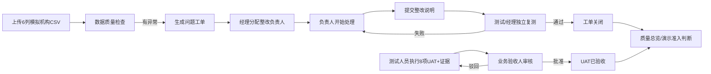
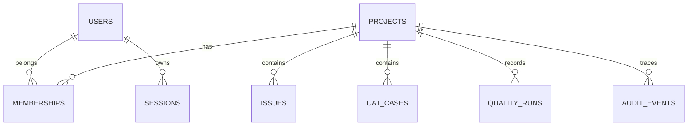

# 流程、数据模型和指标字典

## 1. 端到端流程（已实现主干）

## 2. 数据实体关系（概念层）

数据库物理表结构以 `app/models.py` 为准。SQLite仅本地；PostgreSQL作为目标部署数据库。对象级项目访问由应用API强制验证，不声称已经配置数据库RLS。

## 3. CSV数据字典（严格只允许六列）

| 字段 | 格式 | 约束 | 样例 |
|---|---|---|---|
| institution_id | 字符串 | 非空、一个批次内唯一 | H001 |
| institution_name | 字符串 | 非空；虚构名称，不应包含个人资料 | 朝阳模拟医院 |
| system_code | 字符串 | 非空 | HIS-A |
| status | 枚举 | active/testing/inactive | active |
| success_rate | 数字 | 0–100（百分比） | 98.2 |
| go_live_date | ISO日期 | YYYY-MM-DD | 2026-11-01 |

规则针对 **CSV中的单次快照数据**，不是实时医院接口调用；模型没有访问任何真实医疗系统。

## 4. 工单数据字典

| 字段 | 作用 | 必填 |
|---|---|---|
| id | UUID型唯一标识 | 自动 |
| project_id | 所属项目 | 自动 |
| title | 可识别的问题标题 | 是 |
| description | 现象、影响、预期 | 否 |
| category | 功能或数据质量 | 默认功能 |
| severity | low/medium/high/critical | 是 |
| status | open/in_progress/ready_for_retest/closed | 自动 |
| assignee_id | 责任用户；须属于项目 | 进入整改前必须 |
| created_by / created_at | 创建人 / 时间 | 自动 |
| due_date | 目标完成日期 | 可选 |
| resolution_notes | 整改措施说明 | 提交复测时必须 |
| retest_notes | 复测记录、结果 | 关闭/退回时必须 |
| fingerprint | 数据异常幂等标识 | CSV异常转换时自动 |

## 5. 指标定义（必须避免歧义）

| 指标 | 口径 | 已实现 |
|---|---|---|
| 总工单数 | 项目下所有工单数量 | 是 |
| 未关闭工单 | status != closed | 是 |
| 高风险阻断数 | severity ∈ {high, critical} 且 status != closed | 是 |
| UAT已验收数 | status == accepted 的项数 | 是 |
| UAT完成比例 | 已验收数 / 全部UAT项数 | 是 |
| 数据质量记录通过率 | 没有任何规则异常的记录数 / 导入总记录数 | 是 |
| 同源异常工单重复数 | 检查批次中已存在相同项目、行号、机构ID、规则指纹的异常数 | 是；有局限 |
| 逾期工单数量 | due_date < 今日且status!=closed | 待实现 |
| 平均整改周期 | 关闭时间减创建时间的统计均值 | 待实现；当前无专门closed_at |

**已知指纹局限**：当前指纹使用 CSV行号 + 机构ID + 规则。在相同CSV重复导入时可去重，但数据重排可能改变行号而导致新工单。下一阶段应改成稳定业务主键 + 规则 + 批次版本 + 抑制策略，并讨论何时允许重新提出长期未整改的异常。

## 6. 简化发布门槛

`ready_for_release = (高/紧急未关闭工单数=0) AND (8项UAT均已由验收人批准)`。

这是方便展示的 **演示性** 判定，不代表医疗行业验收法规、临床验证或企业变更委员会审批。
